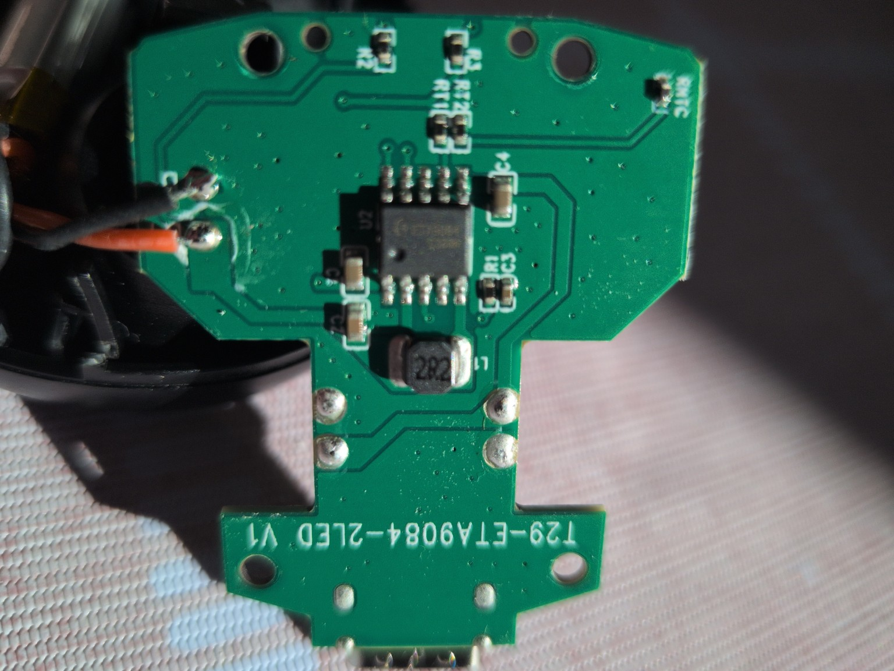
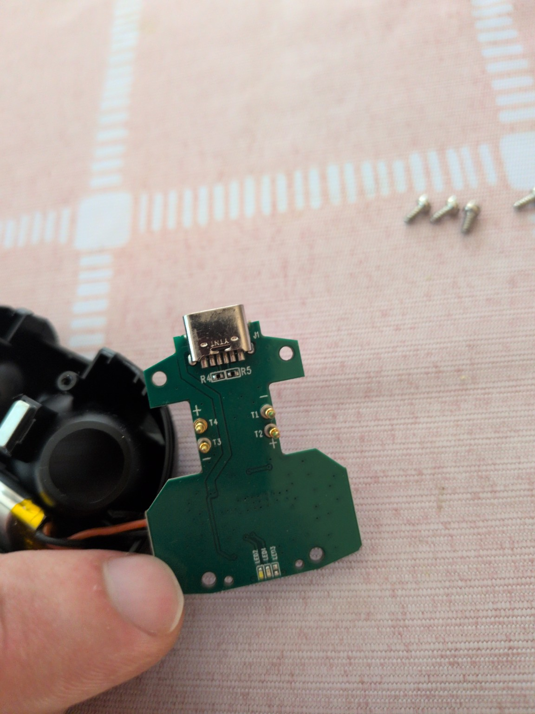

# EutherBlue – nuläge och nästa mätning

Senast uppdaterad: 2026-09-07
Projekt: Linocell BTH13, reserv-laddetui och väg till originalfirmware/röstresurser

## Kort nuläge

Målet är fortfarande att läsa ut originalfirmware från en BTH13-lur utan att
skriva eller radera något, hitta dess JieLi-röstresurser och först därefter
bedöma en modifierad firmware. Ingen fysisk firmwaredump finns ännu och inget
har skrivits till luren eller laddetuiet.

Det öppnade reservetuiets kort använder med hög sannolikhet en ETA9084 som
laddare, 5 V boostomvandlare och batteriindikator. Kretsen har ingen dokumenterad
USB- eller UART-funktion. Kortets `2R2`-spole, tiopinskapsel, batterikablar och
laddutgångar stämmer väl med ETA9084:s typkoppling.

USB-C-kontakten ser ut som en förenklad sexpolig power-only-kontakt. Den aktuella
arbetshypotesen är:

```text
två kontaktpinnar = GND
två kontaktpinnar = parallell VBUS, 5 V in
en kontaktpinne    = CC1 via R4 till GND
en kontaktpinne    = CC2 via R5 till GND
```

R4 och R5 är därför sannolikt två ungefär 5,1 kohm `Rd`-motstånd som deklarerar
etuiet som USB-C-strömsänka i båda kontaktorienteringarna. Detta är ännu inte
bekräftat med noterade resistans- och kontinuitetsvärden. Användarens ursprungliga
hypotes om dold USB/UART ska hållas öppen tills samtliga sex kontaktpinnar är
spårade; ETA9084-databladet ensamt bevisar inte resten av kortets nätlista.

T1–T4 är fjäderkontakterna mot lurarna. Silkscreen tyder på att T2 och T4 är
pluskontakter och att T1 och T3 är retur/GND, men även detta ska verifieras.
Eventuell JieLi `chargestore`-kommunikation är mer sannolik på dessa
laddkontakter än på USB-C-ingången.

## Bevarade originalbilder

Komponentsida:



SHA-256:
`4b29d9c68013c4cbbb684ad5aa913f14e59263d10abb7a6f1510dcafbab82e73`

USB-C- och kontaktsida:



SHA-256:
`6fb0e936d3599053f632145e1510eadd14585f3f044906dee3a578a8cae13cd8`

Bilderna togs 2026-09-03 och kopierades från de tillfälliga
clipboard-filerna till repot 2026-09-07. Hasharna matchar respektive originalfil
i `/tmp` vid kopieringen.

## Nästa steg: strömlös nätkartläggning

Koppla bort både batteriet och USB innan följande mätningar. Anslut inte USB-TTL,
logikanalysator, extern matning eller oscilloskopjord till någon okänd punkt.

Numrera USB-kontaktens sex små lödpinnar `U1`–`U6` från vänster till höger så som
de syns på bilden `usb-contact-side.png`. Fyll sedan i:

```text
U1–GND/skärm:
U2–GND/skärm:
U3–GND/skärm:
U4–GND/skärm:
U5–GND/skärm:
U6–GND/skärm:

R4 över komponenten:
R5 över komponenten:

T1–GND:
T2–GND:
T3–GND:
T4–GND:

T1–T3:
T2–T4:
svart batterikabel–GND:
röd batterikabel–T2:
röd batterikabel–T4:
```

Mät först i resistansläge och använd summern endast för tydlig låg resistans.
Kondensatorer kan göra att värdet börjar lågt och sedan stiger; notera i så fall
både start- och slutvärde. Undvik att lägga mätspetsen direkt på ETA9084:s täta
ben tills de större och säkrare mätpunkterna är kartlagda.

## Beslut efter de strömlösa mätningarna

Om R4 och R5 båda är cirka 5,1 kohm till GND och de återstående fyra USB-pinnarna
är två VBUS plus två GND betraktas USB-C-porten som power-only i normal drift.

Om någon kontaktpinne i stället går genom R4/R5 eller andra komponenter vidare
till ett separat logiknät ska det nätet spåras innan porten klassas som
power-only eller programmeringsbar.

När GND och laddutgångarna är säkert identifierade görs nästa prov passivt:

1. anslut endast etuiets batteri;
2. mät T2 mot T1 och T4 mot T3 med tomt etui;
3. upprepa när respektive lur sätts i och tas ur;
4. notera stabil nivå, min/max och eventuell puls eller periodisk växling;
5. anslut USB-laddning först efter att ovanstående värden har noterats.

Stabil cirka 5 V talar för enkel laddmatning. Pulser vid isättning motiverar en
passiv oscilloskopfångst. En eventuell digital signal provas inledningsvis mot
9600 baud och `55 aa`/`5a a5`, men ingenting får sändas innan nivå och riktning
är fastställda.

## Redan färdigt i repot

- `reports/linocell-bth13-hardware-research-2026-09-03.md` beskriver den möjliga
  JieLi BR30/AC897N-vägen och kravet på två identiska skrivskyddade dumpar.
- `reports/linocell-bth13-chargestore-readonly-path-2026-09-03.md` dokumenterar
  det offline-rekonstruerade halvduplexprotokollet.
- `tools/chargestore_readonly.py` kan endast skapa och avkoda tre tillåtna
  läsfrågor. Det har ingen seriell I/O och kan inte skriva till en fysisk enhet.
- Den lokala röstbanken är endast validerad mot en publik BR30-referensbild och
  är inte en verifierad eller flashbar BTH13-bild.

## Säkerhetsgrind före all firmwareåtkomst

Ingen skrivning eller radering får göras innan målkrets och anslutningar är
identifierade, originalflashen har lästs två gånger, filerna är byte-identiska
och SHA-256 har sparats. Om laddetuiet visar sig vara helt power-only går arbetet
vidare genom att öppna offerluren, fotografera båda kortsidorna och identifiera
JieLi-kretsens egna USB-/LDOIN-/testpunkter.
